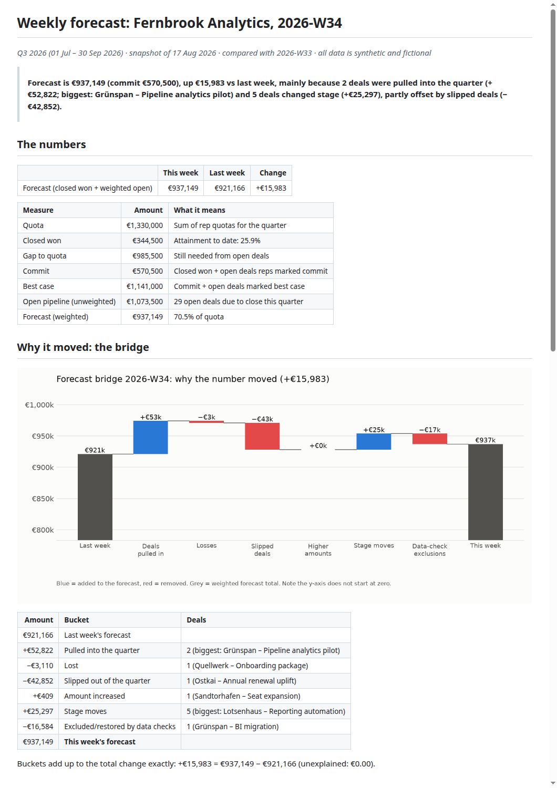
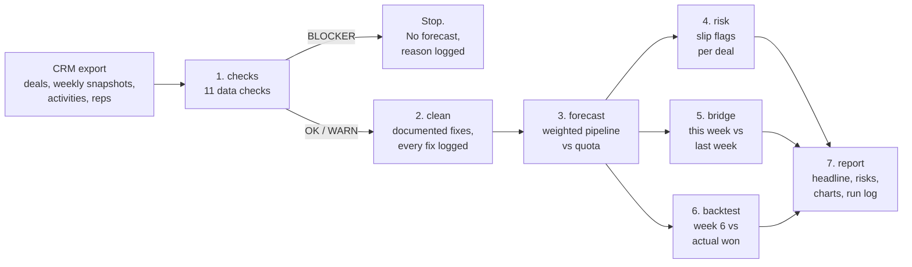

# sales-forecast-sql

**A weekly sales forecast in SQL that checks its own data, and explains in plain English why the number moved since last week.**



## The problem

Most forecasts tell you the number, not why it moved.

On Monday the forecast says €937k. Last Monday it said €921k. In most teams, the next hour goes into working out what happened: which deal slipped, which one was lost, whether a rep just tidied up their stages, or whether a broken record in the CRM quietly changed the total. This project does that hour of work automatically, every week, and writes it down.

## What it does

- **Checks the data first.** Eleven checks run before anything is calculated. Serious problems stop the run; smaller ones are fixed in a documented way, or flagged for a person.
- **Forecasts the quarter.** Closed won plus open deals weighted by how often deals at that stage actually win, compared with quota by rep and by team.
- **Flags deals that are slipping**, each with one plain sentence: "Close date pushed 4 times (first 30 May, now 04 Sep)".
- **Explains the change since last week** as a bridge: new deals, wins, losses, slips, amount changes, stage moves. The pieces add up to the total change, to the cent. Every run is logged with its data week, check results, forecast and the exact code version.
- **Backtests itself.** For each of the past two quarters it rebuilds the forecast as of week 6 and compares it with the closed won that quarter finished with, in EUR and in percent.

## How it works



1. **Checks** (`sql/checks/`): each check is one SQL file that returns the rows that fail. Results go to `data_quality_<week>.md`.
2. **Clean** (`sql/clean/`): duplicates removed, old stage names translated, deals with a missing owner kept under "Unassigned". Every fix is written to a log.
3. **Forecast** (`sql/forecast/`): amount × stage probability. The probability is the historical win rate for that stage when at least 10 closed deals back it up, otherwise a default. The report says which one was used.
4. **Risk** (`sql/risk/`): five warning signs per open deal (pushed close dates, no activity, stage moved backwards, amount cut, too early to close this quarter).
5. **Bridge** (`sql/bridge/`): every deal's change since last week goes into exactly one bucket, so the buckets always add up.
6. **Backtest** (`sql/backtest/`): week 6 of each of the two previous quarters, scored against the closed won those quarters finished with. Written to `output/backtest.md`.
7. **Report** (`sql/report/` + a small Python writer): the headline sentence is written in SQL from the bridge; Python only formats tables and draws two charts.

All business rules live in the `.sql` files. Python generates the sample data and runs the steps in order. The details are in [docs/methodology.md](docs/methodology.md).

## What broke while building it

These are the real problems hit during the build, in the order they came up:

- **The first dataset was not believable.** The first generated CRM had only 84 deals and the forecast landed at 144% of quota. Nobody would trust a report built on that. I tuned how often deals are created and won, and raised the quotas, until the numbers looked like a normal mid-quarter: 43% attainment, forecast close to 100%. That shape belonged to history that started in January 2026. Starting one quarter earlier (the Q1 note below) moved the sample week to 25.9% attainment and a forecast at 70.5% of quota. The creation rate, win rate and quotas were left alone.
- **One injected data problem would have changed the meaning of a deal.** The first version of the "old stage name" problem turned any stage that wasn't Proposal or Negotiation into "Disco", which the cleaning step reads as Discovery. A deal in Qualification would have silently moved up a stage. Caught when reviewing the generator, before the first run, and replaced with a one-to-one list of old names.
- **The sample week was too quiet.** With seed 42, the week of 17 Aug had no slips and no new deals in the quarter, so the report could not show the most important thing it does. The generator now scripts two events in that week (the largest late-stage deal slips into Q4, one Q4 deal is pulled in). Both are written to `injected_issues.json` so nothing is hidden.
- **A DuckDB error when ranking risky deals.** Ranking deals with a window function on top of a `GROUP BY ALL` aggregate fails with "Cannot mix aggregates with non-aggregated columns". Fixed by grouping first, ranking second.
- **The headline read like a machine wrote it.** Early versions said "1 deal with a higher amounts" and "partly offset by lost". Each bridge bucket now has its own singular and plural sentence and a short name for the "offset" part.
- **The bridge named a "biggest deal" for buckets that hadn't moved.** A bucket with €0 change still showed a deal name, because deals with zero change were included. They are now filtered out.
- **The waterfall chart's labels overlapped.** Long bucket names collided under the bars. The chart now uses short labels, wrapped over two lines.
- **One industry label was on the word list.** The generator named an industry with a word the leak scan flags, so that label was renamed to Hospitality and the sample data regenerated. The random draw did not change, so the forecast amounts stayed the same.
- **The licence text collided with the word list.** The standard MIT wording contains a longer word that starts with one list entry. Letter-only entries now have to be a whole token, so the licence file stays as the real MIT text. The entry was not removed from the list.
- **Q1 had no closed won, so the percent error was undefined.** History started on Monday 5 Jan 2026. A new deal begins in Qualification or Discovery and needs several weekly stage moves before it can be won, so in this seed nothing reached Closed Won with a close date inside Q1. The backtest reported €0 actual and left the percent blank. History now starts on Monday 6 Oct 2025, so Q1 already has a pipeline in motion. The errors were not nudged. The weekly simulation has the same shape one quarter earlier, so Q1's miss of +16.8% (forecast €556,700.00, actual €476,500.00, error +€80,200.00) is the previous Q2 book moved one quarter earlier. The new Q2 miss is +7.1% (forecast €1,391,399.10, actual €1,299,500.00, error +€91,899.10).

## Example output

From the sample week (2026-W34, snapshot of 17 Aug 2026):

> **Forecast is €937,149 (commit €570,500), up €15,983 vs last week, mainly because 2 deals were pulled into the quarter (+€52,822; biggest: Grünspan – Pipeline analytics pilot) and 5 deals changed stage (+€25,297), partly offset by slipped deals (−€42,852).**

| Amount | Bucket |
| ---: | :--- |
| €921,166 | Last week's forecast |
| +€52,822 | Pulled into the quarter (2 deals) |
| −€3,110 | Lost (1 deal) |
| −€42,852 | Slipped out of the quarter (1 deal) |
| +€409 | Amount increased (1 deal) |
| +€25,297 | Stage moves (5 deals) |
| −€16,584 | Excluded by data checks (1 deal) |
| **€937,149** | **This week's forecast** (change +€15,983, unexplained €0.00) |


Backtest (week-6 forecast versus the closed won the quarter finished with):

| Quarter | As of | Forecast | Actual closed won | Error |
| :--- | :--- | ---: | ---: | ---: |
| Q1 2026 | 2026-W07 (9 Feb 2026) | €556,700.00 | €476,500.00 | +€80,200.00 (+16.8%) |
| Q2 2026 | 2026-W20 (11 May 2026) | €1,391,399.10 | €1,299,500.00 | +€91,899.10 (+7.1%) |

Full reports: [this week](output/sample/weekly_report_2026-W34.md), [last week](output/sample/weekly_report_2026-W33.md), [backtest](output/backtest.md), [data quality](output/sample/data_quality_2026-W34.md), [run log](output/sample/run_log.csv).

## Run it yourself in 3 commands

You need Python 3.11 or newer and git.

```bash
git clone https://github.com/Alikhosrawi/sales-forecast-sql.git && cd sales-forecast-sql
pip install -r requirements.txt
python run.py
```

The report appears in `output/weekly_report_2026-W34.md`, and the backtest in `output/backtest.md`. Other useful commands:

```bash
python run.py --week 2026-W33   # any week in the data
python -m pytest                # the test suite (37 tests)
bash scripts/leak_scan.sh       # needs a local .leakwords file, or the LEAK_WORDS variable
python generate_data.py         # rebuild the sample data (seed 42, identical every time)
```

If a BLOCKER check fails, the run stops with exit code 2, prints why, and logs the stop in `output/run_log.csv`.

## Tests

Run on every push by GitHub Actions:

- every problem injected into the data is caught by the right check (and the stale-deal and pushed-close-date checks agree with an independent count in plain Python)
- the bridge buckets add up to the total change to the cent, for every week of the quarter and for every single deal
- the forecast equals values worked out by hand on a five-deal fixture ([tests/fixtures/tiny/README.md](tests/fixtures/tiny/README.md))
- the same seed gives byte-identical data and reports
- a BLOCKER stops the run, writes no report and logs the stop
- the backtest runs, its week-6 forecast matches a full pipeline rerun for that week, and the figures in `output/backtest.md` match the run

## Data note

**All data is synthetic and fictional.** Fernbrook Analytics, its 4 reps, 24 accounts and every deal were generated by `generate_data.py`. They are not real companies, people, employers or customers, and any resemblance is a coincidence. The data deliberately contains problems (a duplicate, a negative amount, a missing amount, old stage names, an owner who no longer exists, overdue and stale deals) so the checks have something real to catch.

## Project layout

```
sql/            all business logic, one step per folder, run in file order
pipeline/       loads the CSVs, runs the SQL, writes reports and charts
data/sample/    the synthetic CRM export (seed 42) + injected_issues.json
data/seeds/     stage_aliases.csv: documented translations of old stage names
output/sample/  committed example run: reports, charts, run_log.csv
tests/          pytest suite and the hand-calculated fixture
docs/           methodology.md
```

---

Built by Ali Khosravi with an AI agent as co-pilot. MIT licensed.
