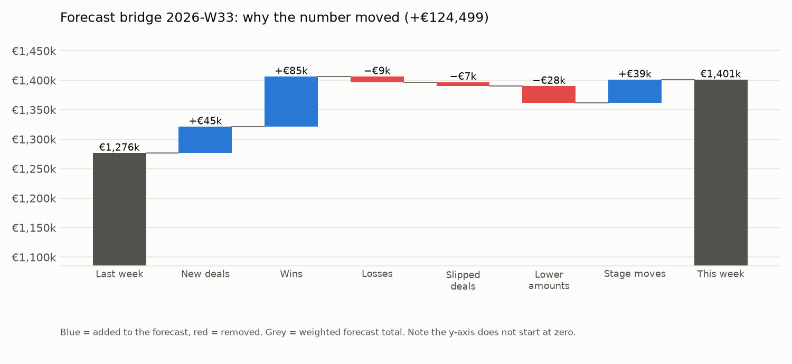
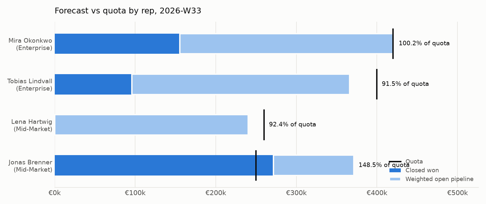

# Weekly forecast: Fernbrook Analytics, 2026-W33

_Q3 2026 (01 Jul – 30 Sep 2026) · snapshot of 10 Aug 2026 · compared with 2026-W32 · all data is synthetic and fictional_

> **Forecast is €1,400,934 (commit €873,500), up €124,499 vs last week, mainly because 1 deal was won (+€85,000: Pfefferland – Onboarding package) and 2 new deals were added (+€44,778), partly offset by lower amounts (−€28,152 across 3 deals).**

## The numbers

|  | This week | Last week | Change |
| :--- | ---: | ---: | ---: |
| Forecast (closed won + weighted open) | €1,400,934 | €1,276,436 | +€124,499 |

| Measure | Amount | What it means |
| :--- | ---: | :--- |
| Quota | €1,330,000 | Sum of rep quotas for the quarter |
| Closed won | €523,000 | Attainment to date: 39.3% |
| Gap to quota | €807,000 | Still needed from open deals |
| Commit | €873,500 | Closed won + open deals reps marked commit |
| Best case | €1,383,500 | Commit + open deals marked best case |
| Open pipeline (unweighted) | €2,198,000 | 36 open deals due to close this quarter |
| Forecast (weighted) | €1,400,934 | 105.3% of quota |

## Why it moved: the bridge

| Amount | Bucket | Deals |
| ---: | :--- | :--- |
| €1,276,436 | Last week's forecast |  |
| +€44,778 | New deals | 2 (biggest: Brückenhof – Reporting automation) |
| +€85,000 | Won (moved to 100%) | 1 (Pfefferland – Onboarding package) |
| −€9,375 | Lost | 1 (Deichgraf – Annual renewal uplift) |
| −€6,972 | Slipped out of the quarter | 1 (Sandtorhafen – BI migration) |
| −€28,152 | Amount decreased | 3 (biggest: Lotsenhaus – Seat expansion) |
| +€39,220 | Stage moves | 8 (biggest: Pfefferland – Onboarding package) |
| €1,400,934 | **This week's forecast** |  |

Buckets add up to the total change exactly: +€124,499 = €1,400,934 − €1,276,436 (unexplained: €0.00).

## Top 5 deals at risk

38 open deals have at least one warning sign. These five count toward this quarter and have the most signs, then the most money at stake.

| # | Deal | Owner | Stage | Amount | Close | Why it is at risk |
| ---: | :--- | :--- | :--- | ---: | :--- | :--- |
| 1 | Brückenhof – Pipeline analytics pilot | Jonas Brenner | Negotiation | €42,000 | 28 Aug | Close date pushed 2 times (first 23 Jun, now 28 Aug); No activity for 32 days; Amount cut 41% (from €71,000 to €42,000) |
| 2 | Pfefferland – Data quality audit | Mira Okonkwo | Qualification | €90,000 | 27 Sep | No activity for 44 days; Moved back from Discovery to Qualification (week of 10 Aug); Due to close 27 Sep but still in Qualification |
| 3 | Ilmenau – Seat expansion | Tobias Lindvall | Qualification | €60,000 | 03 Sep | No activity for 22 days; Amount cut 30% (from €86,000 to €60,000); Due to close 03 Sep but still in Qualification |
| 4 | Lotsenhaus – Seat expansion | Lena Hartwig | Discovery | €0 | 25 Aug | Close date pushed 2 times (first 04 Aug, now 25 Aug); No activity for 113 days; Due to close 25 Aug but still in Discovery |
| 5 | Tidenhub – Seat expansion | Mira Okonkwo | Proposal | €57,500 | 04 Sep | Close date pushed 4 times (first 30 May, now 04 Sep); Amount cut 30% (from €82,500 to €57,500) |

## Forecast vs quota by rep

| Rep | Team | Quota | Closed won | Attainment | Commit | Best case | Forecast | Gap to quota |
| :--- | :--- | ---: | ---: | ---: | ---: | ---: | ---: | ---: |
| Mira Okonkwo | Enterprise | €420,000 | €155,500 | 37.0% | €269,000 | €391,500 | €421,002 | €264,500 |
| Tobias Lindvall | Enterprise | €400,000 | €96,000 | 24.0% | €165,000 | €324,000 | €366,002 | €304,000 |
| Lena Hartwig | Mid-Market | €260,000 | €0 | 0.0% | €126,000 | €330,000 | €240,191 | €260,000 |
| Jonas Brenner | Mid-Market | €250,000 | €271,500 | 108.6% | €313,500 | €332,500 | €371,200 | €0 (over by €21,500) |
| Unassigned | Unassigned | – | €0 | – | €0 | €5,500 | €2,538 | – |

## Data issues found this run

5 of 11 checks passed; 6 raised warnings, none blocked the run. Full detail: [data_quality_2026-W33.md](data_quality_2026-W33.md)

- **dq_unknown_stage_mapped**: 1 row(s). Stage names match the current stage list (legacy names are translated via stage_aliases.csv).
- **dq_duplicate_deal**: 1 row(s). Each deal appears once in the CRM export and once per weekly snapshot.
- **dq_missing_amount**: 1 row(s). Open deals have an amount.
- **dq_orphan_rep**: 1 row(s). Every deal owner exists in the reps table.
- **dq_stale_no_activity_21d**: 11 row(s). Open deals have at least one logged activity in the last 21 days.
- **dq_close_date_pushed_2x**: 11 row(s). Open deals have not had their close date pushed out two or more times.

## Backtest

Backtest, week-6 forecast versus actual closed won: Q1 2026 as of 2026-W07 error +€49,600.00 (percent not defined, actual closed won €0.00); Q2 2026 as of 2026-W20 error +16.8% (+€80,200.00).

Full quarter-by-quarter figures: [backtest.md](backtest.md).

## How deals were weighted

| Stage | Probability used | Source | Default |
| :--- | ---: | :--- | :--- |
| Qualification | 23% | historical win rate (n=44) | 10% |
| Discovery | 32% | historical win rate (n=37) | 20% |
| Solution Design | 46% | historical win rate (n=26) | 40% |
| Proposal | 60% | historical win rate (n=20) | 60% |
| Negotiation | 75% | historical win rate (n=16) | 80% |

Historical win rate = share of deals that reached the stage and were won, among deals closed before this quarter. Used when at least 10 such deals exist, otherwise the default. See [docs/methodology.md](../docs/methodology.md).
