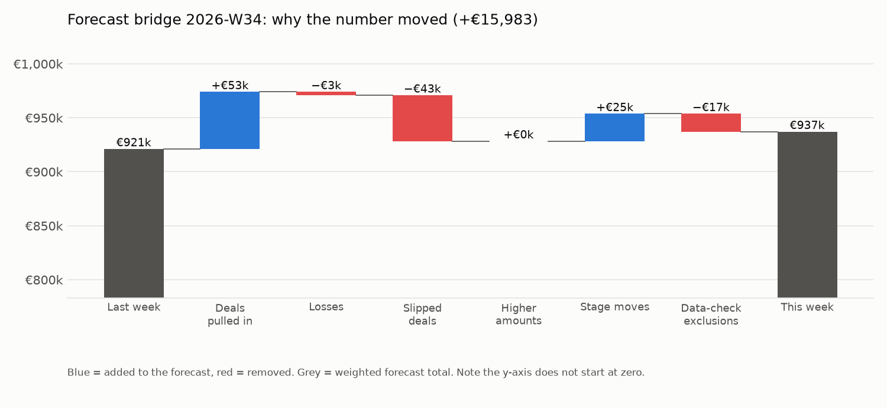
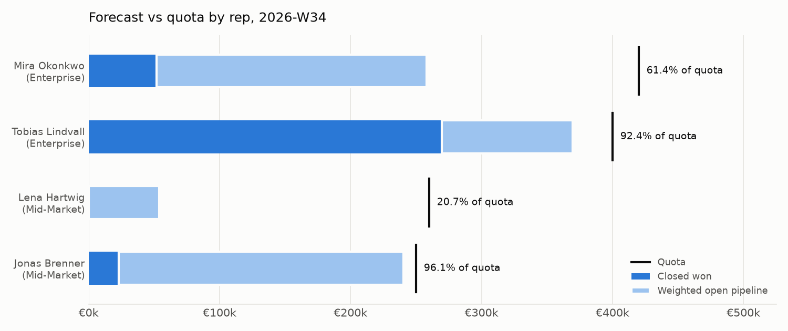

# Weekly forecast: Fernbrook Analytics, 2026-W34

_Q3 2026 (01 Jul – 30 Sep 2026) · snapshot of 17 Aug 2026 · compared with 2026-W33 · all data is synthetic and fictional_

> **Forecast is €937,149 (commit €570,500), up €15,983 vs last week, mainly because 2 deals were pulled into the quarter (+€52,822; biggest: Grünspan – Pipeline analytics pilot) and 5 deals changed stage (+€25,297), partly offset by slipped deals (−€42,852).**

## The numbers

|  | This week | Last week | Change |
| :--- | ---: | ---: | ---: |
| Forecast (closed won + weighted open) | €937,149 | €921,166 | +€15,983 |

| Measure | Amount | What it means |
| :--- | ---: | :--- |
| Quota | €1,330,000 | Sum of rep quotas for the quarter |
| Closed won | €344,500 | Attainment to date: 25.9% |
| Gap to quota | €985,500 | Still needed from open deals |
| Commit | €570,500 | Closed won + open deals reps marked commit |
| Best case | €1,141,000 | Commit + open deals marked best case |
| Open pipeline (unweighted) | €1,073,500 | 29 open deals due to close this quarter |
| Forecast (weighted) | €937,149 | 70.5% of quota |

## Why it moved: the bridge

| Amount | Bucket | Deals |
| ---: | :--- | :--- |
| €921,166 | Last week's forecast |  |
| +€52,822 | Pulled into the quarter | 2 (biggest: Grünspan – Pipeline analytics pilot) |
| −€3,110 | Lost | 1 (Quellwerk – Onboarding package) |
| −€42,852 | Slipped out of the quarter | 1 (Ostkai – Annual renewal uplift) |
| +€409 | Amount increased | 1 (Sandtorhafen – Seat expansion) |
| +€25,297 | Stage moves | 5 (biggest: Lotsenhaus – Reporting automation) |
| −€16,584 | Excluded/restored by data checks | 1 (Grünspan – BI migration) |
| €937,149 | **This week's forecast** |  |

Buckets add up to the total change exactly: +€15,983 = €937,149 − €921,166 (unexplained: €0.00).

## Top 5 deals at risk

27 open deals have at least one warning sign. These five count toward this quarter and have the most signs, then the most money at stake.

| # | Deal | Owner | Stage | Amount | Close | Why it is at risk |
| ---: | :--- | :--- | :--- | ---: | :--- | :--- |
| 1 | Lotsenhaus – Reporting automation | Mira Okonkwo | Solution Design | €161,000 | 10 Sep | Close date pushed 4 times (first 25 May, now 10 Sep); No activity for 17 days; Moved back from Solution Design to Discovery (week of 03 Aug) |
| 2 | Ilmenau – Forecasting module | Jonas Brenner | Discovery | €51,500 | 21 Aug | Close date pushed 3 times (first 04 Jun, now 21 Aug); No activity for 79 days; Due to close 21 Aug but still in Discovery |
| 3 | Grünspan – Data quality audit | Lena Hartwig | Discovery | €47,500 | 30 Aug | Close date pushed 2 times (first 25 Jun, now 30 Aug); Moved back from Solution Design to Discovery (week of 17 Aug); Due to close 30 Aug but still in Discovery |
| 4 | Ilmenau – Forecasting module | Mira Okonkwo | Negotiation | €23,000 | 25 Aug | Close date pushed 6 times (first 29 Mar, now 25 Aug); No activity for 23 days; Amount cut 40% (from €38,500 to €23,000) |
| 5 | Wellenbrecher – BI migration | Tobias Lindvall | Qualification | €35,500 | 31 Aug | Close date pushed 3 times (first 12 Jul, now 31 Aug); No activity for 16 days; Due to close 31 Aug but still in Qualification |

## Forecast vs quota by rep

| Rep | Team | Quota | Closed won | Attainment | Commit | Best case | Forecast | Gap to quota |
| :--- | :--- | ---: | ---: | ---: | ---: | ---: | ---: | ---: |
| Mira Okonkwo | Enterprise | €420,000 | €52,000 | 12.4% | €217,000 | €378,000 | €257,900 | €368,000 |
| Tobias Lindvall | Enterprise | €400,000 | €269,500 | 67.4% | €269,500 | €418,000 | €369,651 | €130,500 |
| Lena Hartwig | Mid-Market | €260,000 | €0 | 0.0% | €0 | €33,500 | €53,737 | €260,000 |
| Jonas Brenner | Mid-Market | €250,000 | €23,000 | 9.2% | €84,000 | €311,500 | €240,314 | €227,000 |
| Unassigned | Unassigned | – | €0 | – | €0 | €0 | €15,548 | – |

## Data issues found this run

3 of 11 checks passed; 8 raised warnings, none blocked the run. Full detail: [data_quality_2026-W34.md](data_quality_2026-W34.md)

- **dq_unknown_stage_mapped**: 2 row(s). Stage names match the current stage list (legacy names are translated via stage_aliases.csv).
- **dq_duplicate_deal**: 2 row(s). Each deal appears once in the CRM export and once per weekly snapshot.
- **dq_negative_amount**: 1 row(s). Deal amounts are not negative.
- **dq_missing_amount**: 1 row(s). Open deals have an amount.
- **dq_orphan_rep**: 1 row(s). Every deal owner exists in the reps table.
- **dq_close_date_in_past**: 1 row(s). Open deals do not have a close date that has already passed.
- **dq_stale_no_activity_21d**: 6 row(s). Open deals have at least one logged activity in the last 21 days.
- **dq_close_date_pushed_2x**: 17 row(s). Open deals have not had their close date pushed out two or more times.

## Backtest

Backtest, week-6 forecast versus actual closed won: Q1 2026 as of 2026-W07 error +16.8% (+€80,200.00); Q2 2026 as of 2026-W20 error +7.1% (+€91,899.10).

Full quarter-by-quarter figures: [backtest.md](backtest.md).

## How deals were weighted

| Stage | Probability used | Source | Default |
| :--- | ---: | :--- | :--- |
| Qualification | 27% | historical win rate (n=88) | 10% |
| Discovery | 41% | historical win rate (n=82) | 20% |
| Solution Design | 56% | historical win rate (n=61) | 40% |
| Proposal | 71% | historical win rate (n=48) | 60% |
| Negotiation | 81% | historical win rate (n=42) | 80% |

Historical win rate = share of deals that reached the stage and were won, among deals closed before this quarter. Used when at least 10 such deals exist, otherwise the default. See [docs/methodology.md](../docs/methodology.md).
